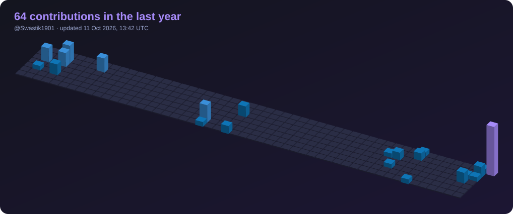
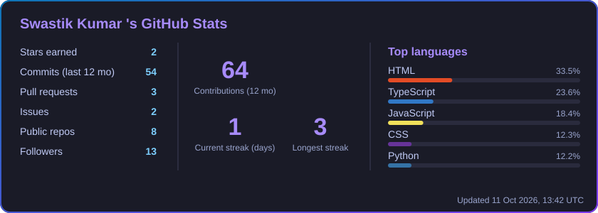

  
  
  
  

---

## 👋 About Me

I'm a **full-stack developer** pursuing a **B.Tech in Artificial Intelligence & Machine Learning** at Heritage Institute of Technology. I like building systems at the intersection of **privacy, networking, and web technologies**: the kind of projects where you have to understand what's happening on the wire, not just in the UI.

- 🔭 **Building:** privacy-enforcing tools and web experiences
- 🌱 **Exploring:** TypeScript, 3D on the web (Three.js + Blender), applied AI
- 💬 **Ask me about:** Full-Stack Development, Node.js, MongoDB, MITM proxies, open source
- 📫 **Reach me:** vardaan1901@gmail.com

---

## 🧊 My Contributions in 3D

<!-- Generated hourly by .github/workflows/profile-3d.yml -->

---

## 🚀 Featured Project

### 🛡️ Sentin-AL: Privacy-Enforcing Proxy Platform

> What if websites had to *pay you* for your data?

Sentin-AL is a privacy-first **MITM proxy** that intercepts HTTP/HTTPS traffic and runs a custom **Data Lease Negotiation Protocol**: a website must agree on a lease price before it receives data like your location, device fingerprint, or browsing activity.

- 🧪 **Data poisoning:** if a site refuses to pay, Sentin-AL injects realistic synthetic noise (fake GPS coordinates, randomized device fingerprints, spoofed user agents) so your real data stays private.
- 💰 **Rate card system:** MongoDB-backed, per-domain pricing across **20+ major websites**.
- 📊 **Live dashboard + wallet:** track transactions and claim privacy earnings in real time.
- 🔐 **On-the-fly TLS:** per-host certificates generated with node-forge to inspect HTTPS traffic.

<!-- Live repo card: stars, forks and language update automatically -->

---

## 🛠️ Tech Stack

---

## 🏆 Hackathons

| Event | Result |
|-------|--------|
| **Smart Bengal Hackathon 2025** | 🥇 Finalist · Team Lead |
| **Hack n Solve, IGDTUW** | 🥇 Finalist |

---

## 🌍 Open Source & Community

- 🪶 **GirlScript Summer of Code (GSSoC) 2024:** first open-source experience, contributed to the **Postman** project
- 🚀 **ECSoC 2026:** Contributor
- 🦈 **Pull Shark** achievement on GitHub
- 🎓 **Google Student Ambassador (2025)**
- 👥 **GDG on Campus**, Heritage Institute of Technology: Member

---

## 📜 Certifications

---

## 📊 Live GitHub Stats

<!-- Generated hourly from the GitHub API by .github/workflows/profile-3d.yml -->

---

### 🤝 Let's connect

I'm always up for collaborating on **privacy, web, and open-source** projects.

