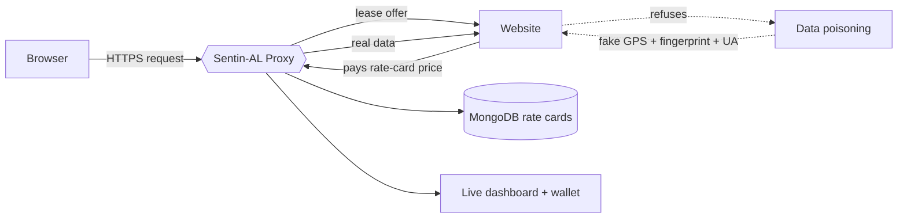

<h1 align="center">Swastik Kumar</h1>

  Full-stack developer &nbsp;·&nbsp; Privacy &nbsp;·&nbsp; Networking &nbsp;·&nbsp; Web

  
  

 

I'm a B.Tech student in Artificial Intelligence & Machine Learning at Heritage Institute of Technology, Patna. I like building at the intersection of **privacy, networking and the web**, the kind of projects where you have to understand what's happening on the wire, not just in the UI.

 

## Currently

| | |
|---|---|
| **Building** | Privacy-enforcing tools and web experiences |
| **Exploring** | TypeScript, 3D on the web (Three.js + Blender), applied AI |
| **Ask me about** | Full-stack development, Node.js, MongoDB, MITM proxies, open source |

 

## Featured project

### [Sentin-AL](https://github.com/Swastik1901/sentin-al) — privacy-enforcing proxy platform

> What if websites had to *pay you* for your data?

A privacy-first MITM proxy that intercepts HTTP/HTTPS traffic and runs a custom **Data Lease Negotiation Protocol**: a site must agree on a lease price before it receives data such as your location, device fingerprint or browsing activity.

- **Data poisoning:** if a site refuses to pay, synthetic noise (fake GPS, randomized fingerprints, spoofed user agents) keeps your real data private.
- **Rate cards:** MongoDB-backed, per-domain pricing across 20+ major websites.
- **Live dashboard and wallet:** track transactions and claim privacy earnings in real time.
- **On-the-fly TLS:** per-host certificates generated with node-forge to inspect HTTPS traffic.

  
  
  
  
  
  

 

## Tech stack

  
  
  
  
  
  
  
  
  
  
  
  
  

 

## Recognition

| Event | Result |
|---|---|
| Smart Bengal Hackathon 2025 | Finalist, Team Lead |
| Hack n Solve, IGDTUW | Finalist |

 

## Open source & community

- **GirlScript Summer of Code 2024:** first open-source experience, contributed to Postman
- **ECSoC 2026:** contributor
- **Google Student Ambassador (2025)**
- **GDG on Campus, Heritage Institute of Technology:** member
- **Pull Shark** achievement on GitHub

 

## Certifications

  
  
  
  

 

## Activity

  

  Open to collaborating on privacy, web and open-source projects.

