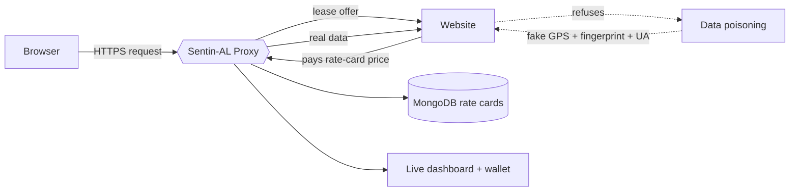

 <h1 align="center">Swastik Kumar</h1>

  

  
  

 

B.Tech student in AI & ML at Heritage Institute of Technology. I like the kind of projects where you have to understand what's happening **on the wire**, not just in the UI. Privacy, networking and the web are my playground, and I break (then fix) things there on purpose.

 

## What I'm up to

- **Building:** privacy-enforcing tools and web experiences
- **Exploring:** TypeScript, 3D on the web (Three.js + Blender), applied AI
- **Ask me about:** full-stack development, Node.js, MongoDB, MITM proxies, open source
- **Fun fact:** I built a proxy that negotiates a price with websites before they're allowed to see your data

 

## Featured project

### [Sentin-AL](https://github.com/Swastik1901/sentin-al): a proxy that makes websites pay

> What if websites had to *pay you* for your data?

A privacy-first MITM proxy running a custom **Data Lease Negotiation Protocol**. A site agrees on a lease price before it gets your location, device fingerprint or browsing activity. If it refuses, it gets convincing fake data instead.

  
  
  
  
  

 

## More things I've built

<table>
  <tr>
    <td></td>
    <td></td>
  </tr>
</table>

 

## Toolbox

  
  
  
  
  
  
  
  
  
  

 

## Wins and community

- **Smart Bengal Hackathon 2025:** Finalist, Team Lead
- **Hack n Solve, IGDTUW:** Finalist
- **GirlScript Summer of Code 2024:** first open-source experience, contributed to Postman
- **ECSoC 2026:** contributor
- **Google Student Ambassador (2025)** and member of **GDG on Campus, HIT**
- **Certified:** Career Essentials in Generative AI (Microsoft & LinkedIn), Postman API Fundamentals, AI Fluency and Claude 101 (Anthropic)

 

## Open to

| | |
|---|---|
| **Internships** | Full-stack, backend or applied AI roles |
| **Open source** | Privacy, web and networking projects, happy to review or contribute |
| **Collabs** | Hackathon teams and side projects that sound slightly too ambitious |

Best way to reach me: [vardaan1901@gmail.com](mailto:vardaan1901@gmail.com) or [LinkedIn](https://www.linkedin.com/in/swastik-kumar19).

 

## Contribution snake

  <picture>
    <source media="(prefers-color-scheme: dark)" srcset="https://raw.githubusercontent.com/Swastik1901/Swastik1901/output/github-snake-dark.svg">
    
  </picture>

  It eats my commits. Keep it fed.

